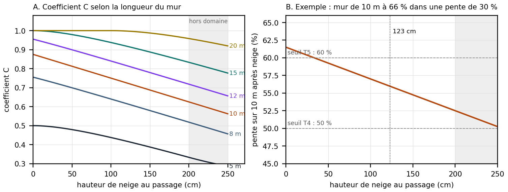

# Ajuster la note T à l'enneigement

Le relief utilisé par TxR est mesuré sans neige. Une fois damée, la neige adoucit les petits accidents du terrain, et un mur court peut perdre une classe quand l'enneigement est bon. Cette page permet de faire le calcul à la main, pour un passage précis, à partir des hauteurs relevées par la station. Elle reprend exactement le modèle de la [méthode](METHODE.md), simplifié sur un point : on suppose la même épaisseur de neige sur toute la longueur du passage.

L'abaque ne parle que de la forme de la piste. La glace, la neige dure, les bosses ou le manque de visibilité rendent une piste plus difficile, jamais plus facile, et le modèle les ignore. Il ne sert donc pas à déclasser une piste, ni à modifier son balisage. Ses paramètres ne sont pas encore calibrés.

## Ce qu'il faut avoir

- Les deux relevés du jour : hauteur totale de neige en bas et en haut du domaine, en centimètres, aux points de relevé habituels de la station, avec leur altitude.
- Pour le passage qui intéresse : son altitude, son orientation, sa longueur et sa pente sans neige, ainsi que la pente de la piste juste avant et juste après. Ces valeurs se lisent dans les résultats TxR de la station, ou se mesurent sur place.

## Étape 1. La hauteur de neige au passage

On répartit d'abord la neige selon l'altitude, en ligne droite entre les deux relevés :

$$h = h_{\mathrm{bas}} + \left(h_{\mathrm{haut}} - h_{\mathrm{bas}}\right) \frac{z - z_{\mathrm{bas}}}{z_{\mathrm{haut}} - z_{\mathrm{bas}}}$$

Au-dessous du point bas, on prend h_bas ; au-dessus du point haut, h_haut. On multiplie ensuite par le facteur d'orientation f, qui dit si ce versant garde plus ou moins de neige que le plat à la même altitude. Ce facteur se calcule pour chaque massif à partir de la climatologie de la neige. Voici, à titre d'exemple, celui du massif Haut-Var/Haut-Verdon (Alpes du Sud) en février, pour une pente de 20° environ :

| Altitude | N | NE | E | SE | S | SO | O | NO |
|---|---|---|---|---|---|---|---|---|
| 1 800 m | 1,30 | 1,27 | 1,02 | 0,68 | 0,60 | 0,72 | 0,95 | 1,20 |
| 2 100 m | 1,12 | 1,12 | 1,05 | 0,74 | 0,74 | 0,82 | 0,96 | 1,08 |
| 2 400 m | 1,04 | 1,06 | 1,12 | 0,92 | 0,94 | 1,02 | 0,95 | 1,06 |

<small>Source : réanalyse S2M de Météo-France, saisons 1996 à 2026, hauteur médiane. Sur les pentes plus raides exposées au sud, le facteur descend beaucoup plus bas (0,05 à 1 800 m pour une pente de 40°). Dans le calcul complet, f est borné entre 0 et 3.</small>

## Étape 2. La longueur lissée par la neige

La neige agit comme une moyenne du profil sur une longueur L qui grandit avec la hauteur h :

$$L = 5 + 5\,h$$

L et h sont en mètres.

Sans neige, L vaut déjà 5 m : c'est l'effet de la dameuse. Avec 1 m de neige, L = 10 m ; avec 2 m, L = 15 m.

## Étape 3. Le coefficient de lissage

La note du mur court regarde la pente sur 10 m. Après lissage, elle vaut :

$$p_{10} = p_{\mathrm{autour}} + \left(p_{\mathrm{mur}} - p_{\mathrm{autour}}\right) \times C$$

où p₁₀ est la pente sur 10 m après neige, p_mur la pente du mur sans neige et p_autour celle de la piste juste avant et après.

C dépend de la hauteur de neige et de la longueur du mur. Il tient compte à la fois du lissage et du fait qu'un mur de moins de 10 m ne remplit pas tout le passage de 10 m. Prendre la ligne qui correspond à la hauteur juste inférieure : c'est le côté prudent.

| Neige au passage | L | mur de 5 m | 8 m | 10 m | 12 m | 15 m | 20 m |
|---|---|---|---|---|---|---|---|
| 0 cm | 5,0 m | 0,50 | 0,76 | 0,88 | 0,96 | 1,00 | 1,00 |
| 25 cm | 6,3 m | 0,49 | 0,73 | 0,84 | 0,93 | 0,99 | 1,00 |
| 50 cm | 7,5 m | 0,48 | 0,70 | 0,81 | 0,90 | 0,98 | 1,00 |
| 75 cm | 8,8 m | 0,46 | 0,67 | 0,78 | 0,87 | 0,96 | 1,00 |
| 100 cm | 10,0 m | 0,44 | 0,64 | 0,75 | 0,84 | 0,94 | 1,00 |
| 125 cm | 11,3 m | 0,41 | 0,61 | 0,72 | 0,81 | 0,91 | 1,00 |
| 150 cm | 12,5 m | 0,39 | 0,58 | 0,69 | 0,78 | 0,89 | 0,99 |
| 175 cm | 13,8 m | 0,36 | 0,55 | 0,66 | 0,75 | 0,86 | 0,97 |
| 200 cm | 15,0 m | 0,33 | 0,52 | 0,62 | 0,72 | 0,83 | 0,96 |

Sur les passages de 30 m, la neige change très peu la pente : pour un mur de 20 m, le coefficient passe seulement de 0,67 sans neige à 0,65 avec 2 m de neige. La note donnée par la règle des 30 m reste donc celle du calcul de référence.

## Étape 4. La note

On compare la pente obtenue aux seuils du mur court, en ligne de pente (sans zigzag), ce qui est la lecture prudente :

| Pente sur 10 m | < 40 % | ≥ 40 % | ≥ 50 % | ≥ 60 % | ≥ 75 % |
|---|---|---|---|---|---|
| Classe | pas de règle | au moins T3 | au moins T4 | au moins T5 | au moins T6 |

La note T du jour est la plus haute entre cette classe et celle que donnent les passages de 30 m.

## Un exemple

Une station relève 60 cm à son point bas (1 600 m) et 140 cm à son point haut (2 400 m). Un mur de 10 m, à 66 % sans neige, se trouve à 2 100 m sur un versant nord, dans une pente de 30 %.

1. Hauteur sur le plat : 60 + (140 − 60) × (2 100 − 1 600) / (2 400 − 1 600) = 110 cm. Versant nord à 2 100 m : f = 1,12, soit h = 123 cm.
2. L = 5 + 5 × 1,23 ≈ 11,2 m.
3. Ligne prudente du tableau, 100 cm, colonne « mur de 10 m » : C = 0,75. Pente sur 10 m : 30 + (66 − 30) × 0,75 = 57 %.
4. 57 % est entre 50 et 60 % : le mur donne au moins T4 ce jour-là. Sans neige (C = 0,88), il donnait 61,7 %, soit au moins T5.

## Domaine de validité

Le modèle a été construit pour des hauteurs au passage allant jusqu'à 2 m environ. Au-delà, L dépasse 15 m, bien plus que le passage de 10 m que l'on juge : le lissage efface alors presque tout mur court et le modèle n'a plus de base. On garde la valeur à 2 m. Les paramètres 5 m et 5 × h n'ont pas été mesurés. Ils ont été choisis comme hypothèse de travail, et le [protocole de validation](VALIDATION.md) prévoit de les vérifier.

Dans le calcul complet, la neige n'est pas uniforme : elle varie avec l'altitude et l'orientation le long de la piste. Il arrive alors qu'un passage se raidisse quand la neige augmente, par exemple si le haut d'un ressaut, plus à l'ombre, en reçoit nettement plus que le bas. L'abaque manuel, qui suppose une épaisseur uniforme, ne peut que faire baisser la pente. Ces cas sont à vérifier sur place.

## Le tableau précalculé de la station

Le calcul complet produit, pour une station, un tableau à double entrée qui évite tout calcul quotidien. Les lignes donnent la hauteur relevée en bas, par pas de 25 cm. Les colonnes donnent la hauteur relevée en haut, par pas de 50 cm. Chaque case liste seulement les pistes dont la note T change par rapport à la référence, par exemple « piste X : T5 → T4 ». Une case vide veut dire que rien ne change. On lit le tableau en arrondissant les deux relevés au pas inférieur.

## Un usage possible au quotidien

1. Le service des pistes fait le relevé du matin, avant l'ouverture, toujours aux mêmes points de référence et sur neige de piste.
2. Il lit la case correspondante du tableau de la station, ou applique cet abaque au passage qui l'intéresse.
3. Il note le relevé et les notes dans la main courante.
4. Si une piste sort plus difficile que ce qu'on attend de sa couleur, il va voir le passage signalé et décide lui-même : signalisation d'un danger ponctuel, damage, ou fermeture partielle.

Le classement par couleur ne change jamais à cause de TxR. Il relève de la procédure habituelle de la station.
