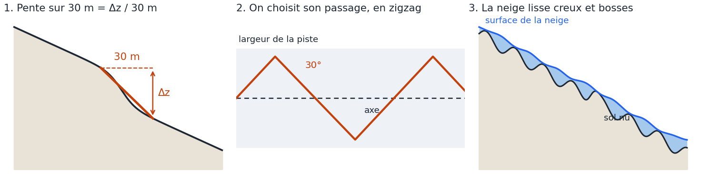

# TxR — méthode (Technical × Resistance)

TxR est une méthode de classement des pistes de ski qui remplace la couleur
unique par **deux notes indépendantes** :

- **T, technique** (T0 à T6) : difficulté du passage le plus raide, mesurée sur
  des fenêtres de 30 m (et de 10 m pour les murs courts) ;
- **R, résistance** (R0 à R5) : exigence physique, d'après le dénivelé.

L'exposition (E) et les conditions du jour (C) restent des indicateurs à part.
La méthode a été mise au point sur La Foux d'Allos (Val d'Allos) à partir de
données publiques : OpenStreetMap, IGN LiDAR HD et RGE ALTI, Météo-France S2M.

> **Statut : recherche, provisoire.** Les seuils sont expérimentaux et les
> hypothèses de correction (couloir, neige, zigzag à 30°) n'ont pas été
> vérifiées sur le terrain. Les classes produites sont des bornes inférieures
> et ne remplacent en aucun cas le balisage des stations.

## Contenu

| fichier | contenu |
|---|---|
| `fiches/methode-grand-public.pdf` | la méthode en une page, pour les skieurs |
| `fiches/methode-exploitants.pdf` | la méthode et l'usage quotidien, pour une station |
| `fiches/methode-technique.pdf` | la méthode en une page, version technique |
| `fiches/*.md` | sources des fiches (les `{{…}}` sont remplacés par les chiffres d'une exécution) |
| `METHODE.md` | description complète : géométrie, profils, pentes, convergence, correction, contrôle |
| `HYPOTHESES.md` | choix de méthode et hypothèses, avec leur source et les variantes essayées |
| `VALIDATION.md` | protocole proposé pour valider la méthode sur neige damée |

## Licence

Textes, fiches et figures : **Creative Commons Attribution 4.0 International**
(CC BY 4.0, voir `LICENSE`). Citer : « TxR — méthode, S. Geffroy, 2026 ».

Les fiches citent des résultats agrégés obtenus à partir de données
© contributeurs OpenStreetMap (ODbL 1.0), IGN et Météo-France (Licence Ouverte
Etalab 2.0). L'implémentation (code sous EUPL-1.2) n'est pas publiée à ce stade.
