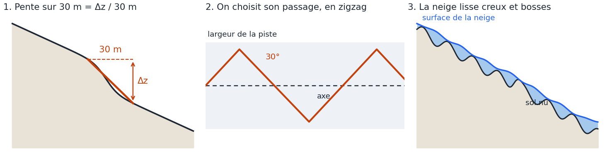

# TxR — *Technical × Resistance*

**Une méthode pour classer les pistes de ski avec deux notes indépendantes plutôt qu'une couleur.**

- **T, technique** (T0 à T6) : la difficulté du passage le plus raide, mesurée sur des fenêtres de 30 m (et de 10 m pour les murs courts).
- **R, résistance** (R0 à R5) : l'exigence physique, d'après le dénivelé.

Une piste courte mais raide peut être **T5·R1** ; une longue piste facile, **T1·R4**. Les deux notes ne se compensent pas. L'exposition et les conditions du jour restent des indicateurs à part.

> **Statut : recherche, provisoire.** Les seuils sont expérimentaux et les hypothèses de correction (couloir, neige, zigzag à 30°) n'ont pas été vérifiées sur le terrain. Les classes produites sont des bornes inférieures et ne remplacent en aucun cas le balisage des stations.

## Comment on mesure

1. Le relief vient du **LiDAR HD de l'IGN** (sol nu, un point tous les 50 cm) ; les tracés viennent d'**OpenStreetMap**.
2. La pente est calculée tous les mètres sur des fenêtres de **10, 30 et 100 m** ; T vient de la fenêtre la plus raide.
3. Une correction **expérimentale** estime la piste damée : couloir de la largeur de la piste, zigzag, neige qui comble les creux (réanalyse **Météo-France S2M**). Une hauteur de neige relevée en bas et en haut de station permet de recalculer la note du jour.

## Ce qu'on sait, ce qu'on ne sait pas encore

Testée sur les 42 pistes de La Foux d'Allos, la méthode classe les pistes **dans le même ordre** que leurs couleurs officielles (τ-b de Kendall ≈ 0,74). En revanche, le **niveau absolu** des classes dépend des hypothèses de correction : la part de pistes « conformes » à leur couleur passe de 10 à 32 sur 42 selon l'angle de zigzag supposé. Ce n'est donc pas une validation ; le [protocole de validation](VALIDATION.html) propose des mesures sur neige damée.

## Documents

| Pour qui | Document |
|---|---|
| Skieurs | [Fiche grand public (PDF, 1 page)](fiches/methode-grand-public.pdf) |
| Stations | [Fiche exploitants (PDF, 1 page)](fiches/methode-exploitants.pdf) |
| Technique | [Fiche technique (PDF, 1 page)](fiches/methode-technique.pdf) |
| Tous | [Méthode complète](METHODE.html) · [Hypothèses et choix](HYPOTHESES.html) · [Protocole de validation](VALIDATION.html) |

## Citer, réutiliser

Textes, fiches et figures sous licence [Creative Commons Attribution 4.0](https://creativecommons.org/licenses/by/4.0/deed.fr) : réutilisation libre, avec citation de la source. Citer : *Geffroy, S. (2026). TxR — méthode. https://github.com/s-geffroy/txr-methode*.

Données d'origine : © contributeurs [OpenStreetMap](https://www.openstreetmap.org/copyright) (ODbL 1.0) ; IGN et Météo-France (Licence Ouverte Etalab 2.0). Les noms et couleurs des pistes sont relevés sur le plan officiel de Val d'Allos.

[Dépôt source sur GitHub](https://github.com/s-geffroy/txr-methode)
